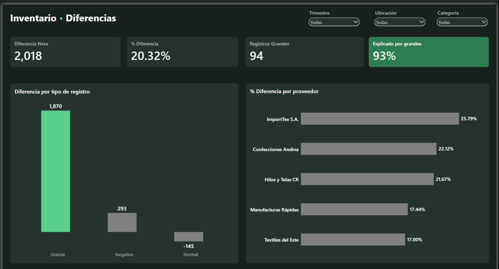

# Análisis de inventario — Uniformes La Pradera S.A.

Proyecto de portafolio: auditoría de inventario con Excel, SQL Server y Power BI.
Los datos son ficticios, creados para practicar.

## Hallazgo principal

El inventario no cuadra: el stock físico es 20.32 % mayor que el del sistema, una diferencia neta de 2,018 unidades en 2,464 registros.
Casi toda esa diferencia (93 %) viene de solo 94 registros (3.8 %) con diferencias de 10 unidades o más, y en 88 de ellos el físico es mayor que el del sistema.
Estos registros no se concentran en una sucursal, una fecha ni un SKU: están repartidos por todo el inventario, lo que descarta un problema puntual en un lugar.
La causa exacta aún no la conocemos; una hipótesis es la forma en que se registran los movimientos, pero con estos datos no podemos confirmarla.

## Dashboard




## Cómo está hecho

1. **Excel y Power Query:** limpieza de las 5 tablas del dataset (12,134 registros) y creación de la tabla Calendario.
2. **Power Pivot:** modelo en estrella con Productos al centro, relacionado por SKU, y exploración con tablas dinámicas para descartar hipótesis rápido.
3. **SQL Server:** carga de las tablas, consultas de análisis y una vista (`vw_Inventario_Detalle`) que alimenta el dashboard.
4. **Power BI:** modelo, medidas DAX y dashboard con 4 tarjetas y 2 gráficos.

## Estructura del repositorio

```
├── images/
│   └── dashboard-caso-1.png
├── powerbi/
│   ├── medidas_dax.md
│   └── tema_la_pradera.json
└── sql/
    ├── 00_crear_tablas.sql
    ├── 01_descomposicion_por_tipo.sql
    ├── 02_exactitud_real.sql
    ├── 03_negativos_por_sucursal.sql
    ├── 04_compras_atrasadas.sql
    ├── 05_lead_time_real_vs_diferencia.sql
    └── 06_vista_inventario_detalle.sql
```


## Límites del análisis

- Los datos son ficticios, generados con IA para practicar; los resultados no describen una empresa real.
- La diferencia de 20.32 % es neta: los registros con físico mayor y menor se compensan. Medida con valor absoluto, el error llega a 51.88 % del stock del sistema.
- La causa de la diferencia no se conoce. El análisis muestra que no se concentra en un SKU, una sucursal ni una ubicación, pero no explica por qué ocurre.
- El lead time real de los 5 proveedores se parece al % de diferencia (r = 0.833), pero con solo 5 proveedores es una pista, no una conclusión.
